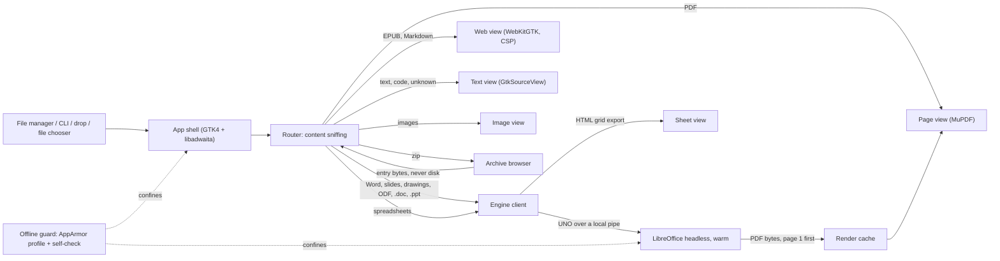
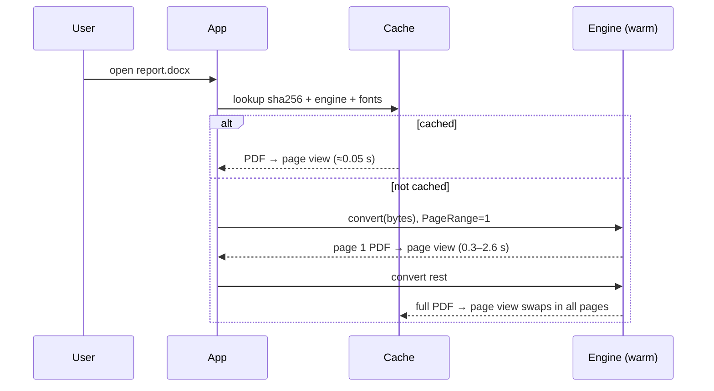

# Design Document

## Overview

Sovander is a native GNOME app for Ubuntu that shows documents and never touches the network. It mixes three
engines, chosen by measurement (`spike/RESULTS.md`): **LibreOffice's layout engine**, run headless and kept
warm, lays out every office file; **MuPDF** draws every PDF, including the ones the engine produces; **light
renderers** show books, Markdown, text and images. One page view serves PDFs, Word, slides and drawings, so
search, selection, zoom, night mode and print are written once.

**Purpose:** accurate, fast, offline reading of office files on Ubuntu. **Users:** anyone who receives Office
files. **Impact:** new project; reuses Gander's EPUB/Markdown code (MIT) and its zip-name and hostile-file lessons.

### Goals

- Office files laid out as an office suite lays them out (spike: 95.8% vs 82.8% of Word text shown; 14/14 vs 0/14 sheet colours).
- First page in 0.3–2.6 s with the engine warm (spike), PDFs in 0.05 s.
- Offline proven by the operating system, and shown to the user, not just promised.

### Non-Goals

Editing, macros, cloud, media playback, OCR, arm64, non-Ubuntu packaging (Requirements: Out of Scope).

## Architecture



- **Pattern:** one process for the UI, one long-lived engine process, both confined by one AppArmor profile.
  The UI talks to the engine over an AF_UNIX pipe, so denying all internet sockets breaks nothing.
- **Boundaries:** viewers never parse office formats themselves; the engine never touches the UI.

### Technology Stack

| Layer | Choice (Ubuntu 22.04 / 24.04 package) | Role |
|---|---|---|
| Language | Python 3.10+ (`python3`) | All three engines have first-class Python bindings in the archive; no compiled code, so the package is `Architecture: all` |
| UI | GTK 4.6+/4.14 (`gir1.2-gtk-4.0`), libadwaita 1.1+/1.5 (`gir1.2-adw-1`) | Native look, dark mode, HiDPI; code targets the 22.04 API floor |
| Office engine | LibreOffice 7.3+/24.2 headless (`libreoffice-*-nogui`, `python3-uno`) | Layout of all office formats |
| PDF | MuPDF via PyMuPDF 1.19+/1.23 (`python3-fitz`) | Rendering, text, search, links |
| Books, Markdown | WebKitGTK 6.0 (`gir1.2-webkit-6.0`, 2.50+ on both) + Gander's `epub.js`, marked, DOMPurify | Same pages Gander ships, same CSP |
| Text | GtkSourceView 5 (`gir1.2-gtksource-5`), `python3-charset-normalizer` | Highlighting, encodings, 5 MB paging |
| Images | GdkPixbuf + `heif-gdk-pixbuf`, `libavif-gdk-pixbuf` | JPG, PNG, WebP, GIF, BMP, SVG, TIFF, HEIC, AVIF |
| Zip | `zipfile` + `python3-cryptography` (WinZip AES) | Listing, ZipCrypto and AES entries |
| Fonts | `fonts-crosextra-carlito`, `-caladea`, `fonts-liberation2` | Metric matches for Calibri, Cambria, Arial, Times (3.7) |
| Confinement | AppArmor 3/4 (`apparmor`) | Network denied by the kernel (9.1, 9.7) |
| i18n | gettext (`po/ru.po`) | English and Russian (14) |

## File Structure Plan

```
sovander/
├── app.py                 # Gtk.Application: open/command-line/drop, windows, about, language switch
├── router.py              # content sniffing (magic bytes, zip members, OLE), format → view (2.11, 7)
├── engine/
│   ├── process.py         # starts/keeps/restarts headless LibreOffice on a pipe, private profile, watchdog
│   ├── client.py          # UNO: load (Hidden, ReadOnly, no macros, no link updates), export PDF/HTML, from bytes
│   └── macros.py          # detects macro parts (vbaProject.bin, Basic/, OLE Macros) for the note (10.2)
├── cache.py               # render cache: key = sha256(content)+engine+fonts, LRU 1 GB, purge (9.10, 11.3)
├── views/
│   ├── page_view.py       # MuPDF pages: zoom, fit, go-to, page counter, progressive pages (3, 5)
│   ├── render.py          # fitz lock (PyMuPDF is not thread-safe), worker thread, page textures, tile cache
│   ├── selection.py       # text selection and copy on the page view (3.5)
│   ├── night.py           # light/dark inversion keeping hue, photos untouched (12.2)
│   ├── present.py         # full-screen presentation mode (5.4, 5.5)
│   ├── sheet_view.py      # tabs, address and formula bar, find, loading state (4)
│   ├── sheet_grid.py      # custom-drawn virtualised grid: frozen headers, fills, merged cells (4.1, 4.4)
│   ├── web_view.py        # WebKitGTK host: custom URI scheme, CSP, all other requests refused (2.6, 2.8)
│   ├── text_view.py       # GtkSourceView, encoding, 5 MB "Show more" (2.9, 7.1, 7.3)
│   └── image_view.py      # zoom, animation (2.7)
├── find.py                # one search bar, per-view search backends, "3 of 17" (6)
├── links.py               # internal jumps; web links → confirm → portal OpenURI or copy (3.11, 9.3–9.5)
├── archive.py             # zip listing, AES/ZipCrypto, entry bytes in memory, size caps (8, 10.4)
├── zipnames.py            # name encoding detection incl. cp866/cp1251, manual override (8.5, 8.6)
├── store.py               # recents, positions, settings: JSON, atomic writes, history-off mode (11)
├── offline.py             # self-check: AF_INET socket must fail; status for About (9.1, 9.7)
├── print.py               # Gtk.PrintOperation over page view, engine PDF for sheets (12.5)
└── i18n.py                # gettext setup, locale fallback to English (14.2, 14.3)
data/
├── assets/                # Gander epub.js/epub.css/md, marked, DOMPurify (MIT/Apache), CSP pages
├── sovander.desktop       # MimeType list for "Open With", no default change (1.5)
└── engine-profile.xcu     # engine settings: no update check, no online features, no remote content
packaging/
├── debian/                # control (Depends), rules, postinst (apparmor_parser -r)
├── apparmor/sovander      # deny network inet, inet6; allow unix, dbus, own paths
├── sovander.sh            # launcher: exec aa-exec -p sovander -- python3 -m sovander
└── make-offline-bundle.sh # .deb + dependency .debs in one archive (13.3)
po/ru.po, po/sovander.pot
tests/ (unit/, engine/, offline/, fidelity/, fuzz/), spike/ (kept as evidence)
```

## Components and Interfaces

**Engine** (`engine/process.py`, `engine/client.py`) — Requirements 2.2–2.5, 2.10, 3.6, 3.10, 4, 5, 10.1, 10.5
- Started in the background when the app starts, so PDFs and images open while it warms (spike: 7–10 s start in the snap build).
- `soffice --headless --invisible --norestore --accept="pipe,name=sovander-<uid>;urp;"`, private profile in `~/.cache/sovander/engine`, seeded with `engine-profile.xcu`.
- `convert(src: bytes | Path, kind) -> Iterator[PdfChunk]`: load from an `InputStream` (zip entries never hit disk), `Hidden=True`, `ReadOnly=True`, `MacroExecutionMode=NEVER_EXECUTE`, `UpdateDocMode=NO_UPDATE`; export `PageRange=1` first, then the rest (5.7, spike: 2.6 s vs 6.9 s on a heavy deck).
- `sheet_html(src, sheet) -> GridChunk` for spreadsheets; `formula(src, sheet, cell) -> str` on demand (4.5).
- Watchdog: 60 s per job; on timeout or crash the engine is killed, restarted, and only that document shows an error (10.5).

**Page view** (`views/page_view.py`) — 2.1, 3, 5, 6, 11.2, 12
- PyMuPDF renders visible pages to `Gdk.MemoryTexture` on a worker thread; tiles above 4× zoom.
- Selection and copy from `page.get_text("words")`; links from `page.get_links()`.
- Receives pages progressively and shows a "loading more" row until the engine finishes (5.7).

**Sheet view** — 4. A custom-drawn grid that paints only visible cells (`Gtk.ColumnView` was rejected: a row is a widget, so merged cells cannot span rows and headers cannot freeze), over a grid model parsed from the engine's HTML export, which keeps values as displayed, fills, merges and widths (spike: 14/14 workbooks). Sheet tabs; a selected cell shows its address and, through the engine, its formula. Values are never recalculated (4.2).

**Web view** — 2.6, 2.8. WebKitGTK 6.0 with a `sovander-asset://` scheme serving bundled pages and the document. Every other request is refused in `decide-policy`, and Gander's CSP applies (`script-src 'self'`). Markdown and EPUB HTML pass through DOMPurify, so the XLSX-injection pattern found in Gander has no equivalent here: spreadsheets never become HTML inside the web view.

**Links** — 3.11, 9.3–9.5. Internal targets scroll. Web targets open a dialog showing the full address with Open and Copy. Open calls the desktop portal `org.freedesktop.portal.OpenURI` over D-Bus, so the browser starts outside Sovander's confinement; spawning `xdg-open` as a child would inherit the no-network profile.

**Offline guard** — 9.1, 9.6–9.8. AppArmor profile `sovander` with `deny network inet,` and `deny network inet6,` (unix sockets allowed). The launcher enters it with `aa-exec`, so the engine, spawned as a child, inherits it. At start `offline.py` tries to open an AF_INET socket. Refused is the expected result, and About shows "Offline: verified by the system". If the socket opens, a banner says protection is off. No telemetry code exists (9.6).

**Archive browser** — 8, 10.4. `zipfile` for listing and ZipCrypto, AES-CTR + HMAC-SHA1 (WinZip AE-1/2) through `cryptography`. Entries are read into memory with caps (2 GB expanded, 200,000 entries) and handed to the router as bytes. Name decoding ports Gander's `ZipNames` logic, adding cp866 and cp1251 for Russian archives, with a manual override.

**Store, cache, i18n** — 9.10, 11, 14. Recents and positions are JSON under `~/.local/share/sovander/`, written atomically; a position key is sha256 of the first 64 KB plus the file size (Gander's scheme). Thumbnails and rendered PDFs live under `~/.cache/sovander/`. History off keeps renders in memory only. gettext with an in-app language switch that rebuilds open windows.

## Data Models

| Model | Fields | Notes |
|---|---|---|
| `Recent` | uri, display_name, kind, opened_at, thumb_key | max 50; missing files marked, not dropped (11.4) |
| `Position` | doc_key, page, offset_y, zoom, updated_at | max 500, LRU |
| `RenderEntry` | content_sha256, engine_version, font_set_hash, pages_done, complete, bytes | cache index; incomplete entries resume |
| `Grid` | sheets[name, rows, cols, col_widths, cells{r,c: text, fill, span}] | from HTML export; lazy per sheet |
| `Settings` | language, theme, night_mode, history_enabled, text_page_mb=5 | JSON |

## System Flows



## Error Handling

| Situation | User sees | System does |
|---|---|---|
| Unreadable/missing file (1.6) | Message naming the file and the reason | No crash, nothing cached |
| Engine cannot load (corrupt, encrypted) | "This file is damaged" or password prompt (3.8, 3.9) | Retry with password via `Password` media property |
| Engine timeout or crash (10.5) | Error on that document only | Kill, restart engine, other windows keep their PDFs |
| Partly damaged file (3.10) | Readable pages + notice | Engine's repair mode output used |
| Archive over caps (10.4) | "Too large to open safely" | Stop reading, free memory |
| Engine not installed | Office files: "Install the document engine" with the apt command | PDFs, images, text still work |
| Offline self-check fails | Banner: offline protection off | Logged locally, never sent |

## Testing Strategy

- **Unit (pytest):** router sniffing on Gander's fixtures, zip names (cp437/cp866/cp1251/Shift-JIS), AES vectors, cache keys, store atomicity, i18n completeness (`msgfmt --statistics`: 0 untranslated, 14.5).
- **Engine integration:** the spike corpus plus fixtures through the real engine; regression floor = spike numbers (Word text ≥ 95%, sheet colours 14/14); page-1-first and restart-on-hang tests.
- **Fidelity (NFR):** `spike/compare.py` grown into `tests/fidelity/`, run per release.
- **Offline (9.8):** CI job on an Ubuntu runner loads the AppArmor profile, starts the app, and asserts the self-check reports "verified" and that a document with a remote image triggers no connection (`ss`/audit log). Build fails if `deny network` disappears from the profile.
- **Fuzz (NFR):** mutated corpus files, nightly, 10,000 per family; pass = no app crash or hang (engine restarts count as handled).
- **Performance (NFR):** timed cold and warm opens on the reference machine, release build from the .deb.
- **Platforms:** CI matrix Ubuntu 22.04 and 24.04.

## Decisions

| # | Decision | Rejected | Why |
|---|---|---|---|
| D1 | LibreOffice layout engine for office files | Gander JS renderers | Spike: more text, sheet colours, correct charts, .odp/.odg/.ppt |
| D2 | MuPDF for all page drawing | pdf.js, Poppler | 0.05 s warm on 756 pages; fastest of the C engines in published comparisons |
| D3 | Native GTK4 app in Python | Electron, Tauri | No browser engine needed for office files; Python is where UNO, MuPDF and GTK bindings meet in Ubuntu's archive |
| D4 | .deb + AppArmor | Flatpak | A LibreOffice Flatpak is about 800 MB plus a 670 MB runtime (Flathub API), and Flatpak is not installed on Ubuntu by default |
| D5 | Licence AGPL-3.0-or-later | MIT | PyMuPDF is AGPL; Gander's MIT code is compatible |


## Requirements Traceability

| Req | Components |
|---|---|
| 1 | app, sovander.desktop, router |
| 2 | router, engine, page_view, sheet_view, web_view, text_view, image_view |
| 3 | page_view, engine (passwords, repair), fonts, links |
| 4 | engine (HTML, formula), sheet_view |
| 5 | engine (page 1 first), page_view, present |
| 6 | find |
| 7 | router, text_view |
| 8 | archive, zipnames |
| 9 | offline guard, links, engine-profile.xcu, cache, store |
| 10 | engine (no macros, watchdog), macros, archive caps |
| 11 | store, cache, app (home screen) |
| 12 | night, app (theme, F11), print |
| 13 | packaging (debian, offline bundle) |
| 14 | i18n, po/ |

## Risks to prove early

1. Cold start ≤ 5 s needs a non-snap engine start well under the 7–10 s measured: measure on the .deb engine first.
2. Sheets over 100,000 rows: HTML export may be too slow for 3 s; fallback is exporting only the visible row window.
3. AppArmor and `aa-exec` behaviour for a Python launcher must be verified on both Ubuntu releases.
