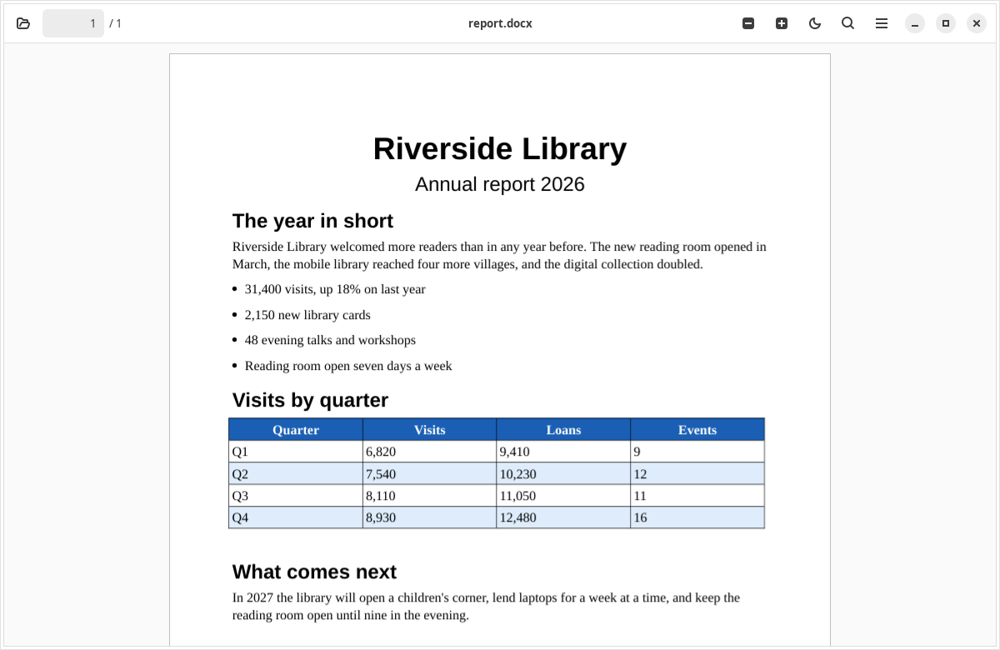
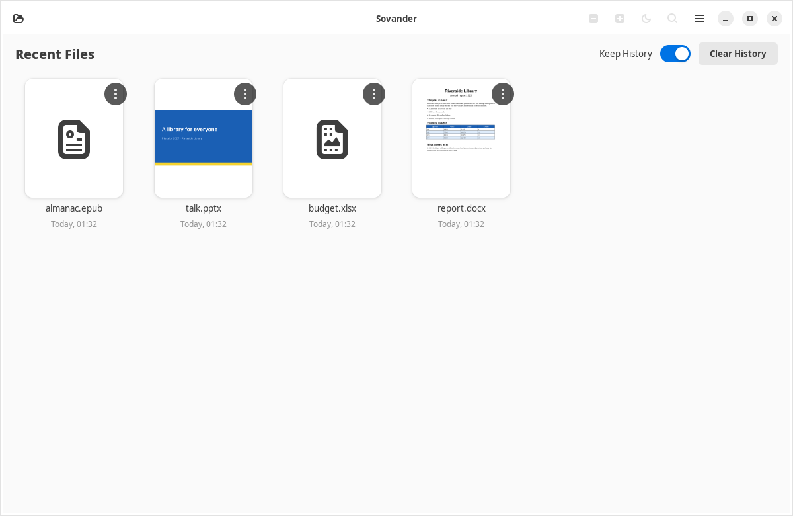
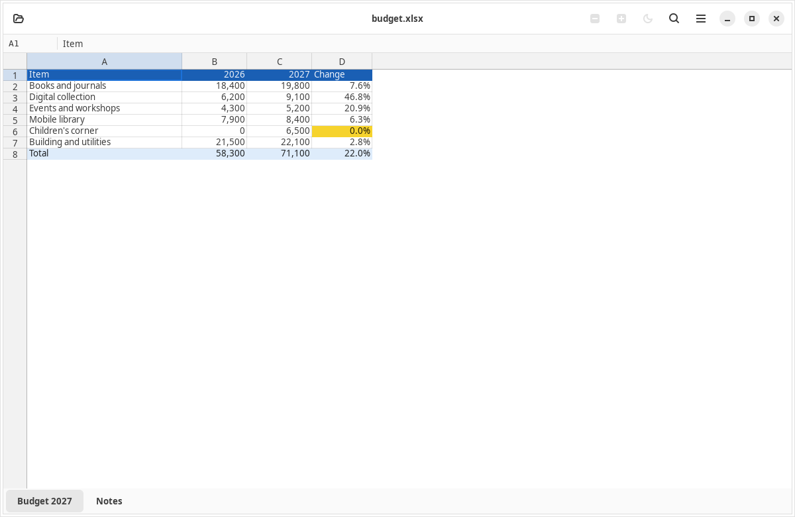
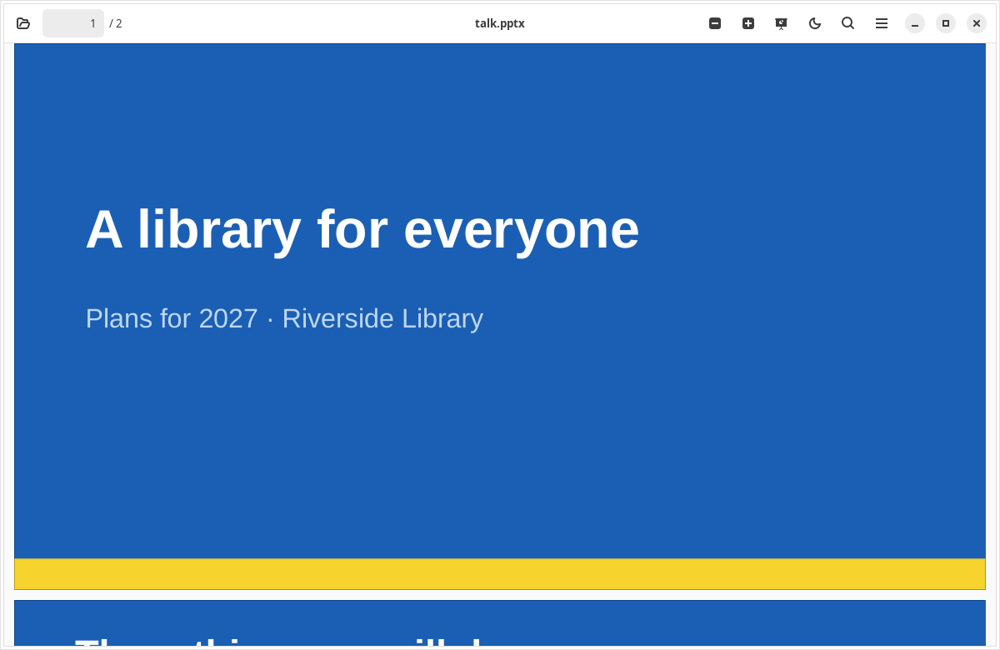
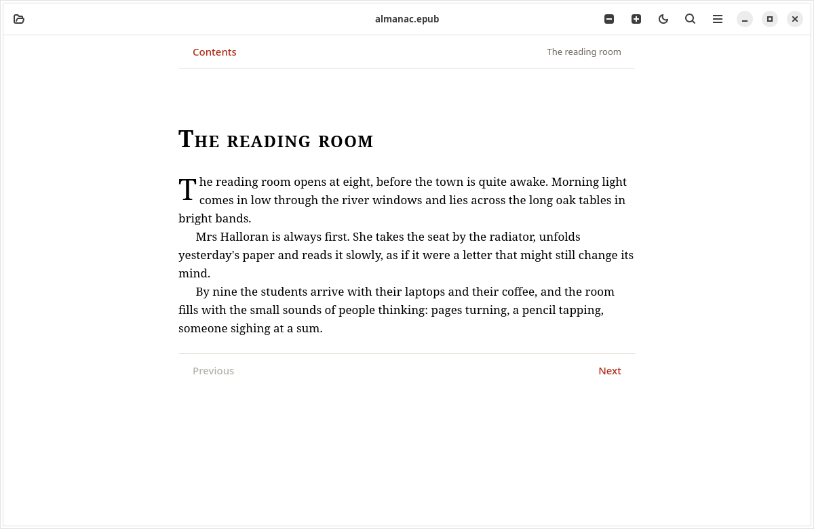

<p align="center">
  
</p>

<h1 align="center">Sovander</h1>

<p align="center">
  <b>Open Word, Excel, PowerPoint, PDF and books on Ubuntu — offline, view-only, accurate.</b><br>
  <a href="README.ru.md">Читать на русском</a>
</p>

<p align="center">
  <a href="https://github.com/khdrvss/Sovander/actions/workflows/ci.yml"></a>
</p>

<p align="center">
  
</p>

Sovander is a document **viewer** for Ubuntu. It opens the files people send you — reports, budgets,
slides, PDFs, e-books — and shows them as their authors laid them out. It never edits, needs no account,
and **cannot go online**: the operating system denies it the network.

- **View-only.** Nothing you open is ever changed or saved. Macros are never run.
- **Offline by design.** An AppArmor profile blocks every network connection for Sovander and every process
  it starts. The app checks this at start and tells you if the protection is not active.
- **Accurate.** Office files are laid out by LibreOffice's own engine, kept running in the background;
  pages are drawn with MuPDF. Fills, merged cells, number formats and slide layouts come through.
- **Fast.** Opening a Word file by launching Sovander shows the first page in about 2 seconds; a large
  Excel or CSV file shows its first screen in a fifth of a second while the rest is prepared.

## Screenshots

| | |
|---|---|
|  |  |
| Recent files with previews | Spreadsheets: sheets, fills, formulas shown as stored |
|  |  |
| Presentations, with a full-screen slide show | E-books with contents and chapters |

## What it opens

| Kind | Formats |
|---|---|
| Documents | DOCX, DOCM, DOTX, DOC, ODT, RTF |
| Spreadsheets | XLSX, XLSM, XLSB, XLTX, XLS, ODS, CSV, TSV |
| Presentations | PPTX, PPSX, PPTM, POTX, PPT, ODP; ODG drawings |
| PDF | including password-protected files |
| Books and text | EPUB, Markdown, plain text, logs, JSON, XML, YAML, TOML, subtitles, source code |
| Images | JPEG, PNG, WebP, GIF (animated), BMP, SVG, TIFF, HEIC/HEIF, AVIF |
| Archives | ZIP: browse it and open any file inside, without unpacking |

Also: find in the document (Cyrillic too), night mode, zoom, a full-screen slide show, printing,
recent files with previews, and links that open only after you confirm them. Not supported: editing,
audio and video, 3D models (shown as text where they are text).

## Install

Sovander runs on **Ubuntu 24.04** (x86-64). Ubuntu 22.04 support is in progress: its older GTK and
PyMuPDF still fail some of the view tests.

**From a release.** Download `sovander_<version>_all.deb` from
[Releases](https://github.com/khdrvss/Sovander/releases) and install it with its dependencies:

```sh
sudo apt install ./sovander_0.1.0_all.deb
```

Sovander then appears in the app menu and in **Open With** for every format above. It does not take over
your defaults. To make it the default for a type, pick it in your file manager's Open With dialog, or
for example: `xdg-mime default io.github.khdrvss.Sovander.desktop application/pdf`.

**On a computer without internet.** Each release also has `sovander-offline-<version>-<codename>.tar`:
Sovander and every package it needs on a fresh Ubuntu of that release. Copy it over, unpack it, and run
the one command in its `INSTALL.txt` (`sudo apt install --no-install-recommends ./*.deb`).

**Remove:** `sudo apt remove sovander`.

## How the offline guarantee works

1. The package installs an AppArmor profile for Sovander that denies `inet` and `inet6` sockets. The
   profile also covers the LibreOffice engine and the web view, because Sovander starts them.
2. At every start Sovander tries to open network sockets itself. If it can, a banner says that offline
   protection is off.
3. Links in documents never open by themselves: Sovander shows the address and asks; if you agree, your
   browser opens it outside Sovander.
4. Printing goes through Ubuntu's print service (CUPS) on its local socket, only when you print; CUPS,
   not Sovander, talks to a network printer.

The CI checks this on every change: it installs the package on GitHub's Ubuntu machines, runs Sovander
inside its profile and verifies that it cannot reach the network while local sockets still work
(`tests/offline/`). Remote pictures in documents are never fetched, and LibreOffice's own network
features are switched off in the engine's private profile.

## Languages

English and Russian. The app follows the system language and can be switched in the menu. Translations
live in `po/`; see [CONTRIBUTING.md](CONTRIBUTING.md) to add one.

## Build and test

Sovander is Python 3 with GTK 4 and libadwaita. On Ubuntu:

```sh
sudo apt install python3-gi gir1.2-gtk-4.0 gir1.2-adw-1 gir1.2-gtksource-5 gir1.2-webkit-6.0 \
    python3-fitz python3-uno libreoffice-writer-nogui libreoffice-uiconfig-writer libreoffice-calc-nogui \
    libreoffice-impress-nogui libreoffice-draw-nogui python3-cryptography python3-charset-normalizer \
    python3-pytest xvfb
python3 -m sovander [file]                         # run from the checkout
python3 -m pytest -m "not engine and not gui"      # fast tests
xvfb-run -a python3 -m pytest -m gui               # the views
python3 -m pytest -m engine                        # with LibreOffice
packaging/build-deb.sh                             # dist/sovander_<version>_all.deb
```

How it was built — requirements, design and the measurements behind the engine choice — is in
`.kiro/specs/` and `spike/RESULTS.md`.

## Licence and credits

Sovander is free software under the [GNU AGPL 3.0 or later](LICENSE) (PyMuPDF, which draws the pages, is
AGPL). Made by Saidxon Xaydarov.

It stands on [LibreOffice](https://www.libreoffice.org/) (layout engine), [MuPDF](https://mupdf.com/) and
[PyMuPDF](https://github.com/pymupdf/PyMuPDF) (pages), [GTK](https://gtk.org/),
[libadwaita](https://gitlab.gnome.org/GNOME/libadwaita) and [WebKitGTK](https://webkitgtk.org/). The
EPUB and Markdown pages, the zip name decoding, the file-type routing and part of the test files come from
[Gander](https://github.com/mokshablr/gander) by Arjun Maniyani (MIT), with marked, DOMPurify and JSZip;
see [data/assets/LICENSES.md](data/assets/LICENSES.md) and `packaging/debian/copyright`.

Found a security problem? Please read [SECURITY.md](SECURITY.md) and report it privately.
