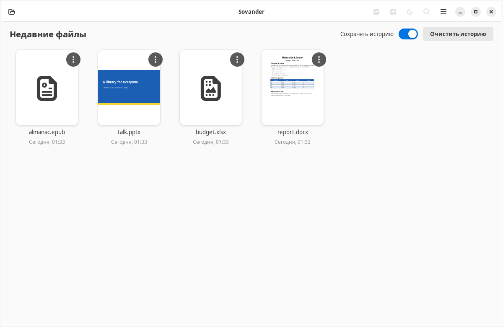
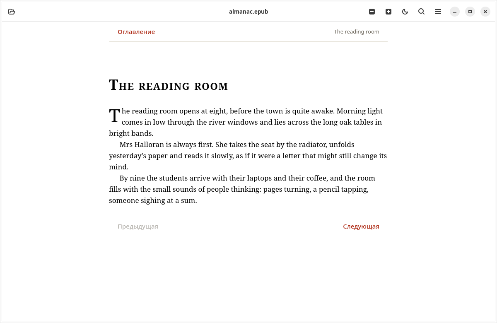

<p align="center">
  
</p>

<h1 align="center">Sovander</h1>

<p align="center">
  <b>Word, Excel, PowerPoint, PDF и книги в Ubuntu — без интернета, только просмотр, точно как в оригинале.</b><br>
  <a href="README.md">Read in English</a>
</p>

<p align="center">
  <a href="https://github.com/khdrvss/Sovander/actions/workflows/ci.yml"></a>
</p>

<p align="center">
  
</p>

Sovander — программа для **просмотра** документов в Ubuntu. Она открывает файлы, которые вам присылают, —
отчёты, бюджеты, презентации, PDF, электронные книги — и показывает их так, как их сверстал автор. Она ничего
не редактирует, не требует учётной записи и **не может выйти в интернет**: операционная система не даёт ей
доступа к сети.

- **Только просмотр.** Открытый файл никогда не меняется и не сохраняется. Макросы не запускаются.
- **Без интернета по устройству.** Профиль AppArmor запрещает сетевые соединения Sovander и всем процессам,
  которые она запускает. При каждом запуске программа это проверяет и предупредит, если защита не работает.
- **Точно.** Файлы Office раскладывает на страницы движок LibreOffice, который работает в фоне; страницы
  рисует MuPDF. Заливки, объединённые ячейки, форматы чисел и макеты слайдов сохраняются.
- **Быстро.** Если открыть файл Word запуском Sovander, первая страница появляется примерно через 2 секунды;
  у большого файла Excel или CSV первый экран — за пятую долю секунды, пока готовится остальное.

## Снимки экрана

| | |
|---|---|
|  |  |
| Недавние файлы с миниатюрами | Таблицы: листы, заливки, формулы как в файле |
|  |  |
| Презентации и показ слайдов на весь экран | Электронные книги с оглавлением и главами |

## Что открывает

| Тип | Форматы |
|---|---|
| Документы | DOCX, DOCM, DOTX, DOC, ODT, RTF |
| Таблицы | XLSX, XLSM, XLSB, XLTX, XLS, ODS, CSV, TSV |
| Презентации | PPTX, PPSX, PPTM, POTX, PPT, ODP; рисунки ODG |
| PDF | в том числе защищённые паролем |
| Книги и текст | EPUB, Markdown, обычный текст, журналы, JSON, XML, YAML, TOML, субтитры, исходный код |
| Изображения | JPEG, PNG, WebP, GIF (с анимацией), BMP, SVG, TIFF, HEIC/HEIF, AVIF |
| Архивы | ZIP: можно смотреть содержимое и открывать любой файл без распаковки |

А также: поиск по документу (и по-русски), ночной режим, масштаб, показ слайдов, печать, недавние файлы
с миниатюрами и ссылки, которые открываются только после вашего подтверждения. Не поддерживается:
редактирование, аудио и видео, 3D-модели (текстовые показываются как текст).

## Установка

Sovander работает в **Ubuntu 24.04** (x86-64). Поддержка Ubuntu 22.04 в работе: с её более старыми GTK
и PyMuPDF часть тестов интерфейса пока не проходит.

**Из выпуска.** Скачайте `sovander_<версия>_all.deb` на странице
[Releases](https://github.com/khdrvss/Sovander/releases) и установите вместе с зависимостями:

```sh
sudo apt install ./sovander_0.1.0_all.deb
```

После этого Sovander появится в меню приложений и в пункте **Открыть с помощью** для всех форматов выше.
Программы по умолчанию она не меняет. Чтобы открывать ею какой-то тип файлов по умолчанию, выберите её в
окне «Открыть с помощью» файлового менеджера или, например:
`xdg-mime default io.github.khdrvss.Sovander.desktop application/pdf`.

**На компьютере без интернета.** К каждому выпуску приложен `sovander-offline-<версия>-<кодовое-имя>.tar`:
Sovander и все пакеты, которые ей нужны в чистой Ubuntu этой версии. Перенесите архив, распакуйте и
выполните одну команду из `INSTALL.txt` (`sudo apt install --no-install-recommends ./*.deb`).

**Удаление:** `sudo apt remove sovander`.

## Как устроена работа без интернета

1. Пакет устанавливает профиль AppArmor, который запрещает Sovander сокеты `inet` и `inet6`. Профиль
   распространяется и на движок LibreOffice, и на веб-просмотр, потому что их запускает Sovander.
2. При каждом запуске Sovander сама пытается открыть сетевые сокеты. Если это удаётся, появляется
   предупреждение, что защита выключена.
3. Ссылки в документах сами не открываются: Sovander показывает адрес и спрашивает; если вы согласны,
   ссылку откроет ваш браузер, вне Sovander.
4. Печать идёт через службу печати Ubuntu (CUPS) по её локальному сокету и только когда вы печатаете;
   с сетевым принтером общается CUPS, а не Sovander.

CI проверяет это при каждом изменении: устанавливает пакет на машинах Ubuntu в GitHub, запускает Sovander
внутри её профиля и убеждается, что сеть недоступна, а локальные сокеты работают (`tests/offline/`).
Картинки из интернета в документах никогда не загружаются, а сетевые функции самого LibreOffice выключены
в отдельном профиле движка.

## Языки

Английский и русский. Программа следует языку системы, его можно сменить в меню. Переводы лежат в `po/`;
как добавить свой — в [CONTRIBUTING.md](CONTRIBUTING.md).

## Сборка и тесты

Sovander написана на Python 3 с GTK 4 и libadwaita. Команды сборки и тестов — в разделе
[Build and test](README.md#build-and-test) английского README.

## Лицензия и благодарности

Sovander — свободная программа под лицензией [GNU AGPL 3.0 или новее](LICENSE) (PyMuPDF, который рисует
страницы, распространяется под AGPL). Автор — Saidxon Xaydarov.

В основе — [LibreOffice](https://www.libreoffice.org/) (движок вёрстки), [MuPDF](https://mupdf.com/) и
[PyMuPDF](https://github.com/pymupdf/PyMuPDF) (страницы), [GTK](https://gtk.org/),
[libadwaita](https://gitlab.gnome.org/GNOME/libadwaita) и [WebKitGTK](https://webkitgtk.org/). Страницы
EPUB и Markdown, распознавание имён в zip, определение типа файла и часть тестовых файлов взяты из
[Gander](https://github.com/mokshablr/gander) (автор — Arjun Maniyani, MIT), вместе с marked, DOMPurify и JSZip;
подробнее — [data/assets/LICENSES.md](data/assets/LICENSES.md) и `packaging/debian/copyright`.

Нашли проблему безопасности? Прочитайте [SECURITY.md](SECURITY.md) и сообщите о ней конфиденциально.
